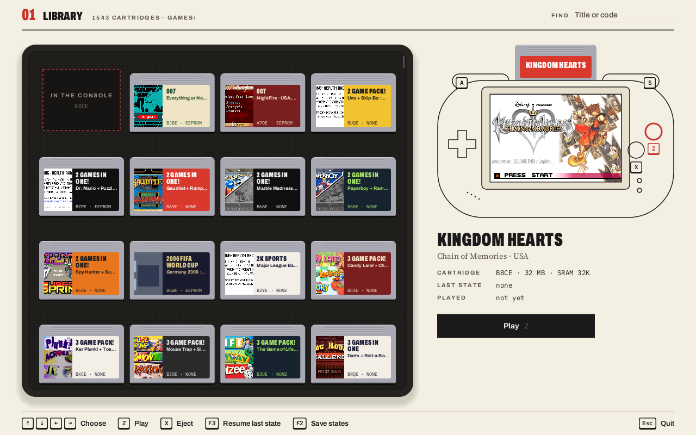
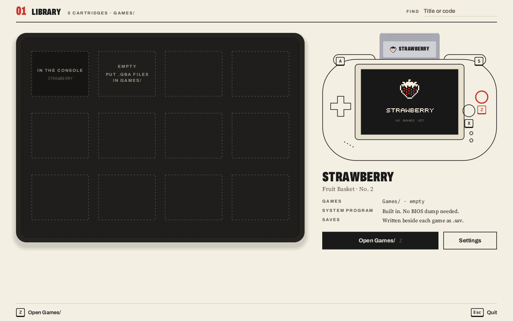
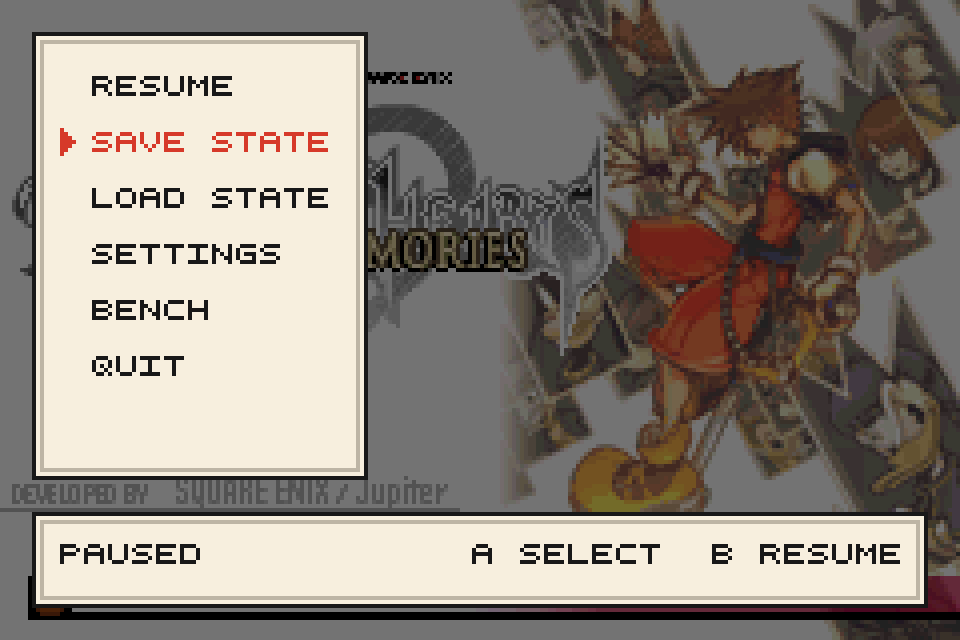
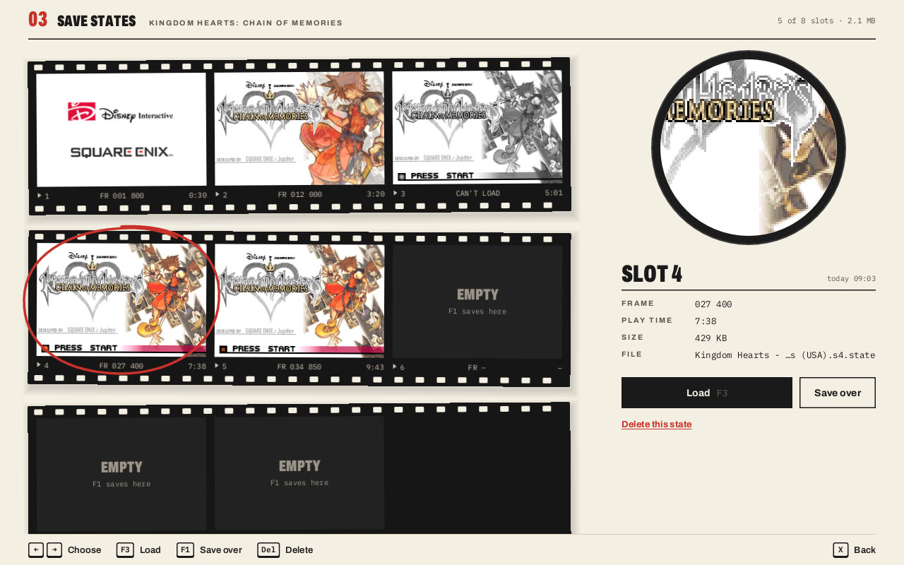
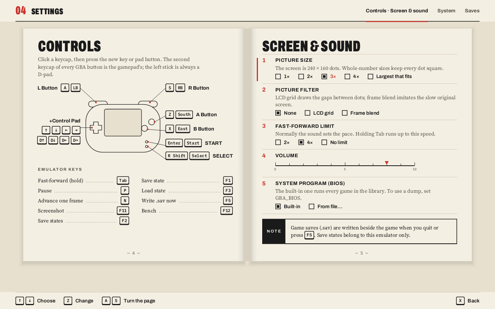
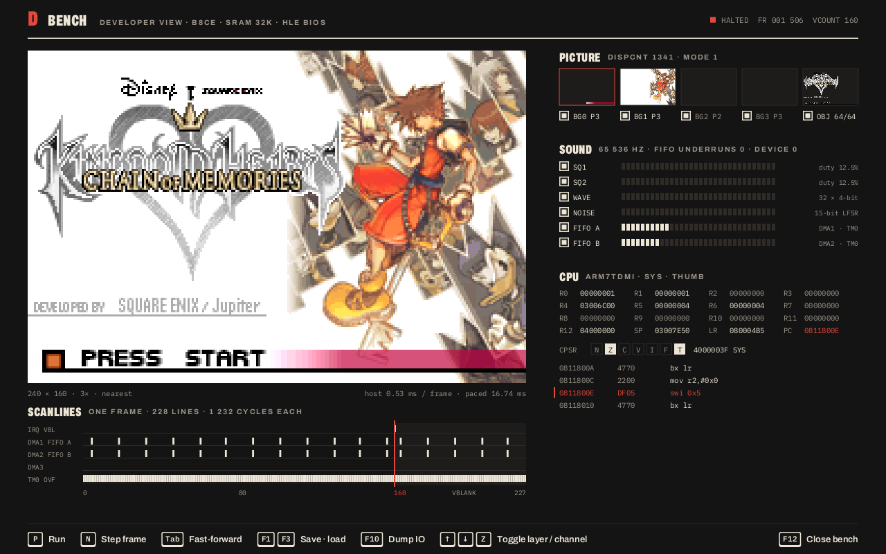
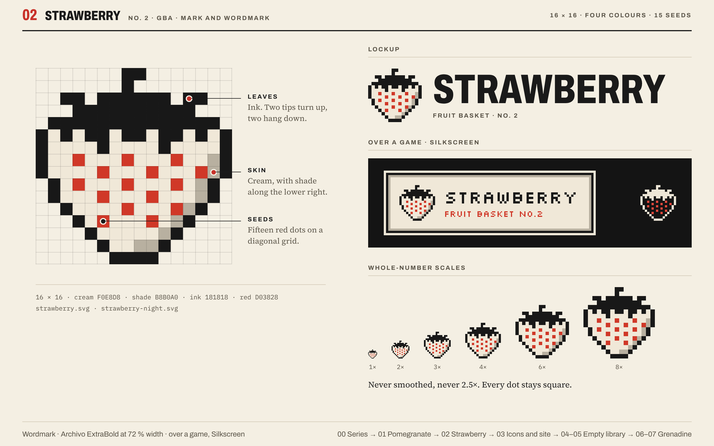

<picture>
  <source media="(prefers-color-scheme: dark)" srcset="docs/branding/logo/png/strawberry-lockup-night@2x.png">
  
</picture>

# Strawberry

Strawberry is a from-scratch Game Boy Advance emulator in Rust: ARM7TDMI interpreter, PPU, APU,
DMA, timers, cartridge backup memory and a high-level-emulated BIOS, with a pure-Rust desktop
player and a headless test harness. Built against the GBATEK hardware documentation.

Kingdom Hearts: Chain of Memories, the Zelda titles (Minish Cap, A Link to the Past & Four
Swords, both Classic NES Series games), Initial D: Another Stage and twenty-three further commercial
titles (Final Fantasy, Mario, Crash, Need for Speed, Max Payne, ...) reach controllable gameplay
under scripted headless runs pinned in `tests/compat.toml`. A sweep of a 1,543-title library
(`docs/library-compat.md`) boots 1,528 to a moving picture with sound; the rest are menus the
sweep does not answer and three open bugs. The BIOS sound driver (the m4a mixer and its
track-command routines) is emulated, so no BIOS image is needed for music. The mgba test suite scores Timing
2020/2020, Memory 1552/1552, DMA 1244/1244 and Timer count-up 936/936. See `PROGRESS.md` for the
exact state of every subsystem.

## Download

Ready-to-run builds for Windows, macOS (Intel and Apple Silicon) and Linux x64 are on the
[Releases page](https://github.com/0x000NULL/GBA_Emulator/releases) as
`strawberry-vX.Y.Z-<os>.zip` / `.tar.gz`, each holding the `strawberry` binary and
`QUICKSTART.md`, which covers running it, the keys and where saves are kept.

## Build and run

Requires stable Rust (1.85+). No C toolchain, cmake or SDL is needed.

```powershell
cargo build --release --workspace
cargo run --release -p gba-frontend                              # opens the library
cargo run --release -p gba-frontend -- "path\to\game.gba"       # or play straight away (.zip containing one .gba also works)
```

The player is a small GUI in the style of a 2001 game box ("paper, ink, one red";
`docs/gui/`): a **library** of cartridges scanned from your game folders (add them in Settings or
with `--library DIR`; the folder of a ROM given on the command line is included), an in-game
**pause menu** drawn inside the frame (resume, save/load one of eight state slots, settings,
bench, quit), a **save states** screen with film-strip thumbnails, a **settings** manual
(controls with keyboard and gamepad rebinding, picture size and filters, fast-forward limit, volume, BIOS,
folders, audio device, autosave), and a **bench** developer view (per-layer pictures, channel
meters, scanline event timeline, CPU registers and disassembly).

Saves are written beside the ROM as `<rom>.sav`; save states as `<rom stem>.s1.state` …
`.s8.state`, each with its picture as `<rom stem>.s<N>.png` (an older single `<rom>.state` is
picked up as slot 1). Settings live in
`%APPDATA%\strawberry\settings.toml`, the library index and title pictures in
`%LOCALAPPDATA%\strawberry\` (`covers\<rom stem>.png` is a copy for the Fruit Basket launcher). No BIOS image is required. If you have one, set
`GBA_BIOS` to its path (or pass `--bios`, or choose it in Settings) and it is used instead of the
built-in HLE.

## Screens

Renders of the player at its 1280×800 design size (`docs/screenshots/`, written by the render
tests below).

<table>
  <tr>
    <td><br>
      <b>Library.</b> Cartridges in a case, the chosen one in the handheld with its title picture.</td>
    <td><br>
      <b>Empty library.</b> The Strawberry cartridge is what is in the console until you add games.</td>
  </tr>
  <tr>
    <td><br>
      <b>Pause menu.</b> Drawn inside the frame at native 240×160, scaled with the game.</td>
    <td><br>
      <b>Save states.</b> Eight slots on film strips, a grease-pencil ring on the chosen one.</td>
  </tr>
  <tr>
    <td><br>
      <b>Settings.</b> An open manual: rebind keys and pad buttons, picture, sound, system, saves.</td>
    <td><br>
      <b>Bench.</b> Developer view: layers, channel meters, a scanline timeline, CPU state.</td>
  </tr>
</table>

### Controls

| GBA | Keyboard | Gamepad |
|---|---|---|
| A / B | Z / X | South / East |
| L / R | A / S | LB / RB |
| Start / Select | Enter / Right Shift | Start / Select |
| D-pad | Arrow keys | D-pad or left stick |

All of these can be rebound in Settings (every GBA button shows a keyboard keycap and a gamepad
keycap; click one and press the new key or pad button); the menus navigate with the same
bindings (A confirm, B back, L/R turn pages).

Hotkeys: **Esc** or **P** pause menu (on a gamepad: **Guide**, or **Select+Start** held for a
second), **Tab** (held) fast-forward, **N** frame step,
**F1 / F3** save / load the current slot, **F2** save states screen, **F5** write the `.sav`
now, **F10** dump IO registers to the console, **F11** screenshot, **F12** bench, **= / -** more
or less sunlight on the Boktai carts' solar sensor (also the pause menu's SUN row). The window is
resizable and the picture is always drawn at a whole-number scale on a dark letterbox;
`--scale N` fixes the picture at N× in a window of exactly that size, `--fullscreen` covers the
display with a borderless window for that run, `--exit-on-quit` makes the pause menu's QUIT close
Strawberry (exit code 0) instead of opening the library, `--slot N` (1–8) starts the
game from that save-state slot (an empty slot boots normally), `--no-resume` starts from power-on
(what a plain launch already does; it is there for the launcher's Start fresh), `--no-audio` disables
sound, `--fullspeed` removes pacing, `--bench N` runs N frames headless and prints the speed.

## Name and mark

Strawberry is Fruit Basket No. 2. The mark is a 16×16 sprite in four colours (cream, shade, ink
and red: fifteen seeds on the outside), shown at whole-number scales only and never smoothed;
the night variant, outline in cream and seeds in red on a dark ground, is the one on the
handheld's screen in the empty library. The wordmark is Archivo ExtraBold at 72 % width; over a
game the pixel font takes its place. Everything lives in `docs/branding/` (SVG mark, wordmark
and lockups with night versions, `.ico` and PNG icons, the design boards, and `README.txt`, the
designer's note). `gba-frontend/src/ui/brand.rs` parses the SVG mark, so the file in
`docs/branding/` is the one the player draws, on the window and in the exe's icon too.



## Workspace

| Crate | Purpose |
|---|---|
| `gba-core` | The machine. No dependencies by default; the `savestate` feature adds serde + bincode. |
| `gba-test` | Headless harness (`gba-test <rom> --frames N ...`) and the `cargo test` ROM driver. |
| `gba-frontend` | The player (binary `strawberry`): window (`minifb`), software renderer (`tiny-skia`, `fontdue`), audio (`cpal`), gamepads (`gilrs`), pacing, saves, state slots, settings, icons. |

`docs/ARCHITECTURE.md` describes the design; `docs/gbatek/` holds the spec excerpts the code
was written from; `CLAUDE.md` holds the project rules and commands.

## Tests

```powershell
scripts/fetch-tests.ps1                     # clones jsmolka/gba-tests + mgba suite, downloads portable mGBA
$env:GBA_TESTS_DIR = "$PWD\tools\tests"
cargo test --workspace
```

`cargo test` runs the core unit tests (about 380), the frontend's unit tests (about 160;
`cargo test -p gba-frontend --release -- --ignored render_` additionally writes review renders of
every screen to `target/ui-renders/`), every ROM in `tests/golden.toml` (the jsmolka CPU, memory,
BIOS, PPU and save suites, all passing, and the thirteen mgba-suite sub-suites pinned at their
scores) and the 66 commercial-ROM goldens in `tests/compat.toml` (scripted gameplay for the
priority titles, plus 1500-frame rows for the titles whose music goes through the BIOS sound
driver, which also require a minimum number of frames with audio). Commercial rows are skipped
when the ROMs are not present under `Games/`, which is gitignored. The mgba suite ships as
source and needs devkitARM: `tools/tests/suite/suite.gba` is built with its `docker-build.sh`.

## Status in one paragraph

Every milestone of the plan is complete against its headless gate except M8, where savestates,
fast-forward, audio-clocked pacing and the game-pak prefetch buffer are in and only
per-instruction timing refinement remains deferred (no runnable gate beyond the mgba-suite
scores above, which are pinned). The BIOS is high-level emulated, including the sound driver
that six library titles need, so no BIOS image is required for anything the library does
(only the undocumented SWI 20h-24h entries are unimplemented, and no title calls them). Release speed is
about 26x real time headless (1,590 fps on KH:CoM). Live audio has been verified on a real
48 kHz device (zero underruns). Audio has been compared against libmgba with a headless capture
tool (`scripts/build-mgba.ps1`, `scripts/compare-audio.py`): our levels follow GBATEK's stated
maxima and mGBA mixes about 3 dB lower, a difference in convention rather than a bug. The player
takes launcher hooks (`--slot`, `--no-resume`, `--fullscreen`, `--exit-on-quit`, and a gamepad route to the pause
menu) for the Fruit Basket launcher's couch mode. Cartridges with a real-time clock (Pokémon
Ruby, Sapphire and Emerald, Rockman EXE 4.5, Boktai and others) read the computer's clock, and
the Boktai solar sensor takes its light from a 0-10 sun level. Still open: the three boot bugs listed in
`docs/library-compat.md`.
